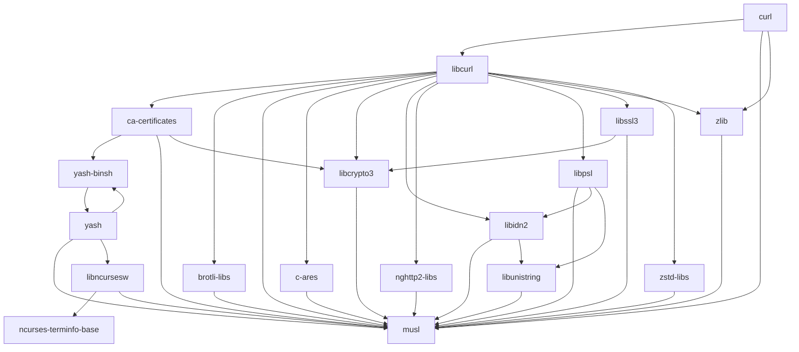
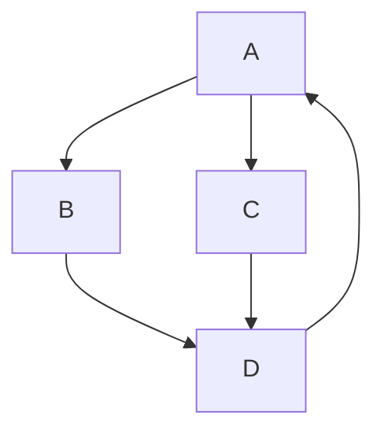

# Визуализатор графа зависимостей (Вариант №9)

## Общее описание

Консольная программа на Python, которая строит граф зависимостей пакетов
Alpine Linux (apk). Готовые менеджеры пакетов и библиотеки для получения
зависимостей не используются.

Статус: **Этап 5 — визуализация** (финальный).

## Функции и настройки

Настройки берутся из JSON-файла (по умолчанию `config.json`):

| Параметр | Что означает | Пример |
|---|---|---|
| `package` | имя анализируемого пакета | `"curl"` |
| `repository` | URL репозитория или путь к файлу тестового репозитория | `"https://.../APKINDEX.tar.gz"` |
| `test_mode` | режим работы с тестовым репозиторием (`true`/`false`) | `false` |
| `output_image` | имя файла с изображением графа (`.png`) | `"graph.png"` |

Программа скачивает индекс репозитория Alpine `APKINDEX.tar.gz`, разбирает
его и выводит полный граф зависимостей пакета `package` (с учётом
транзитивности: зависимости зависимостей).

Как читаются зависимости:

- в индексе каждый пакет — блок строк `буква:значение`, блоки разделены
  пустой строкой; `P:` — имя, `V:` — версия, `D:` — зависимости,
  `p:` — что пакет предоставляет;
- условие на версию отрезается: `libcurl=8.14.1-r2` → `libcurl`;
- записи вида `so:libz.so.1` заменяются на пакет, у которого они есть
  в строке `p:` (здесь `zlib`);
- записи с `!` (конфликты) пропускаются, повторы не выводятся.

Граф строится алгоритмом **BFS с рекурсией** (`src/graph.py`): пакеты
обходятся «волнами» через очередь, а множество уже посещённых пакетов
не даёт зациклиться на циклических зависимостях (например, A → B → A).

### Порядок загрузки зависимостей

После графа программа выводит порядок загрузки: каждый пакет стоит
после всех своих зависимостей (топологическая сортировка). Порядок
получается рекурсивным обходом в глубину (`visit` в `src/graph.py`):
сначала обходятся зависимости пакета, и только потом пакет добавляется
в список. Множество `seen` защищает от повторов и от циклов. Внутри
цикла (A → B → A) правильного порядка не существует, поэтому пакеты
цикла выводятся в порядке обхода.

#### Сравнение с менеджером пакетов apk

Для сравнения `apk` запускался в Alpine Linux 3.12 (x86) в браузере
(https://bellard.org/jslinux/) с установкой в пустую систему:

```
apk -p /tmp/empty --initdb add
apk -p /tmp/empty --allow-untrusted --repositories-file /etc/apk/repositories update
apk -p /tmp/empty --allow-untrusted --repositories-file /etc/apk/repositories --simulate add curl
```

| № | apk (Alpine 3.12) | программа (`tests/stage4_curl_312.json`) |
|---|---|---|
| 1 | musl | musl |
| 2 | busybox | busybox |
| 3 | libcrypto1.1 | libcrypto1.1 |
| 4 | ca-certificates | ca-certificates |
| 5 | nghttp2-libs | nghttp2-libs |
| 6 | libssl1.1 | libssl1.1 |
| 7 | zlib | zlib |
| 8 | libcurl | libcurl |
| 9 | curl | curl |

На репозитории Alpine 3.12 порядок полностью совпал. Расхождения
возможны в других случаях, и вот почему:

- `apk` не устанавливает пакеты, которые уже есть в системе (обычный
  `apk add curl` в готовой системе ничего не поставил — всё было
  установлено). Программа всегда считает систему пустой.
- Одну и ту же возможность могут предоставлять несколько пакетов
  (например, `/bin/sh` — `busybox`, `yash-binsh` и др.). `apk` выбирает
  уже установленный пакет или пакет с наибольшим приоритетом (поле `k:`),
  а программа берёт последний найденный в индексе. Поэтому на Alpine 3.20
  у `curl` в графе появляются `yash-binsh`, `yash`, `libncursesw`.
- Порядок независимых друг от друга пакетов может различаться: важно
  только, чтобы зависимость стояла раньше зависящего пакета.
- `apk` учитывает версии и конфликты (`!`), программа их не проверяет.

### Визуализация (Mermaid и PNG)

Граф выводится на экран на языке диаграмм **Mermaid** и сохраняется
в PNG-файл с именем из параметра `output_image` (`src/visual.py`):

- каждому пакету даётся короткое имя вершины `n0`, `n1`, ..., а имя пакета
  пишется в подписи `n0["curl"]` (в именах пакетов бывают точки и дефисы);
- каждая зависимость — стрелка `n0 --> n1`;
- текст кодируется в base64 и отправляется в сервис mermaid.ink, который
  возвращает PNG-картинку. Сервис используется только для рисования,
  зависимости программа получает сама.

Ошибки: нет сети или не удалось сохранить файл (например, нет папки).

Граф `curl` (Alpine 3.20, `tests/stage5_curl.json`):



Тестовый граф с циклом (`tests/stage5_cycle.json`):



#### Сравнение со штатным инструментом `apk dot`

`apk` умеет выводить граф зависимостей командой `apk dot curl` на языке
Graphviz (проверено в Alpine 3.12 на https://bellard.org/jslinux/):

```
"curl-7.79.1-r1" -> "libcurl-7.79.1-r1"[arrowhead=inv,label="so:libcurl.so.4",];
"curl-7.79.1-r1" -> "zlib-1.2.12-r3"[arrowhead=inv,label="so:libz.so.1",];
"libcurl-7.79.1-r1" -> "nghttp2-libs-1.41.0-r0"[arrowhead=inv,label="so:libnghttp2.so.14",];
...
```

Набор стрелок совпадает с графом программы для того же репозитория.
Расхождения в оформлении и их причины:

- `apk dot` подписывает вершины с версией (`curl-7.79.1-r1`), программа —
  только именем пакета;
- `apk dot` подписывает стрелки тем, что именно требуется
  (`so:libz.so.1`), программа показывает только связь пакетов;
- `apk dot` строит граф только по **установленным** пакетам и выбирает
  уже установленного поставщика (`busybox` для `/bin/sh`), программа
  строит граф по индексу репозитория и берёт последнего найденного
  поставщика — поэтому на Alpine 3.20 у программы появляются `yash`,
  `yash-binsh`, `libncursesw`;
- язык разный: Graphviz (DOT) у `apk`, Mermaid у программы.

### Тестовый режим

При `"test_mode": true` параметр `repository` — путь к текстовому файлу
с графом, где пакеты названы большими латинскими буквами:

```
# комментарий
A: B C
B: D
C: D
D: A
E:
```

Слева от двоеточия — пакет, справа — его зависимости через пробел.
Пустые строки и строки с `#` пропускаются. Ошибки: нет файла, нет
двоеточия в строке, имя пакета не из больших латинских букв.

Обрабатываемые ошибки:

- файл конфигурации не найден;
- файл содержит некорректный JSON;
- конфигурация не является объектом `{ ... }`;
- отсутствует какой-либо параметр;
- `package` или `repository` — не строка или пустая строка;
- `test_mode` — не `true`/`false`;
- `output_image` — не имя файла с расширением `.png`;
- не удалось скачать индекс (нет сети, неверный адрес);
- по адресу лежит не архив `APKINDEX.tar.gz`;
- пакета нет в репозитории;
- ошибки в файле тестового репозитория.

## Запуск и тесты

Нужен Python 3, сторонние библиотеки не требуются.

```
run.bat                         (конфиг config.json)
run.bat tests\bad_values.json   (другой конфиг)
python src\main.py config.json
```

Тест Этапа 1 — `tests\test_stage1.bat`: запускает программу с правильным
конфигом и с пятью ошибочными (нет файла, некорректный JSON, не объект,
нет параметра, неверные значения).

Тест Этапа 2 — `tests\test_stage2.bat`: прямые зависимости `curl`,
`python3`, `musl` (без зависимостей) и ошибки: несуществующий пакет,
несуществующий сайт, адрес не архива, неверный адрес.

Тест Этапа 3 — `tests\test_stage3.bat`: тестовые графы (простой, с циклом,
цепочка, пакет зависит сам от себя, без зависимостей), ошибки тестового
репозитория и полный граф `curl` из настоящего репозитория.

Тест Этапа 4 — `tests\test_stage4.bat`: порядок загрузки для тестовых
графов (простой, цепочка, цикл, A → A, без зависимостей) и для `curl`
в Alpine 3.12 (сравнение с apk) и 3.20.

Тест Этапа 5 — `tests\test_stage5.bat`: текст Mermaid и картинки
`curl.png`, `nano.png`, `jq.png` (три разных пакета), `cycle.png`
(тестовый граф с циклом) и ошибка сохранения в несуществующую папку.
PNG-файлы в репозиторий не добавляются (`*.png` в `.gitignore`).

## Примеры использования

```
> python src\main.py config.json
Граф зависимостей пакета curl:
  curl -> libcurl, musl, zlib
  libcurl -> ...
  ...

> python src\main.py tests\stage3_cycle.json
Граф зависимостей пакета A:
  A -> B, C
  B -> D
  C -> D
  D -> A

> python src\main.py tests\stage2_unknown_package.json
Ошибка: пакет net-takogo-paketa не найден в репозитории

> python src\main.py tests\bad_values.json
Ошибка: package должен быть непустой строкой
Ошибка: test_mode должен быть true или false
Ошибка: output_image должен быть именем файла .png
```
